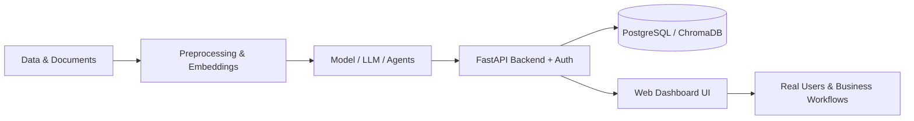

 

 

---

## 🧭 Professional Summary

**Full Stack AI/ML Engineer** with **2+ years of experience** building and deploying **Large Language Model (LLM) applications, Retrieval-Augmented Generation (RAG) systems, AI agents, machine learning models and computer vision solutions** for real business use cases.

I cover the **whole AI product lifecycle**: data and model development, **FastAPI / PostgreSQL backends**, secure authentication, and a working web interface. The result is AI that is **grounded, explainable and production-ready**, not just a notebook demo.

Currently **AI/ML Engineer at Web Synic**.

---

## 📌 Recruiter Snapshot

| | |
|---|---|
| **Title** | Full Stack AI/ML Engineer |
| **Experience** | 2+ years in applied AI/ML |
| **Core strengths** | LLMs · RAG · AI Agents · Computer Vision · ML/DL · FastAPI Backends |
| **Languages** | Python · JavaScript · SQL · HTML/CSS |
| **LLM providers** | OpenAI · Google Gemini · Anthropic · Ollama (local models) · Hugging Face |
| **Deployment & tools** | Docker · Git · PostgreSQL · REST APIs · n8n |
| **Roles of interest** | AI/ML Engineer · GenAI/LLM Engineer · AI Agent Engineer · Computer Vision Engineer · AI Backend Engineer |
| **Work mode** | Open to on-site, hybrid and remote |
| **Contact** | [Email](mailto:00111abdullah00111@gmail.com) · [LinkedIn](https://www.linkedin.com/in/abdullah-1-11-) · [Portfolio](https://abdullahishfaq.netlify.app) |

---

## 🏗️ Full Stack AI: How I Build End to End

| Layer | What I deliver |
|---|---|
| **AI / Model layer** | Prompt and context engineering, RAG pipelines, multi-agent orchestration, tool calling, ML/DL model training and evaluation |
| **Backend layer** | FastAPI services, REST APIs, session-based authentication, role-based access control, PostgreSQL, email (IMAP/SMTP) integrations |
| **Interface layer** | Clean functional dashboards in HTML, CSS and JavaScript (chat UIs, admin panels, live streaming, upload and results views) |
| **Delivery layer** | Git workflow, Docker, documented repositories, recorded live demos |

---

## 🛠️ Technical Skills

| Domain | Technologies |
|---|---|
| **Generative AI & LLMs** | LLM applications · RAG · AI agents · multi-agent systems · LangChain · prompt engineering · context engineering · tool/function calling · OpenAI, Gemini and Anthropic APIs · Ollama · Hugging Face · n8n automation |
| **Vector Search & Embeddings** | ChromaDB · semantic search · Hugging Face and MiniLM embeddings · document chunking |
| **Machine Learning** | Scikit-Learn · XGBoost · LightGBM · class-imbalance handling (SMOTE) · model selection and evaluation (F1, R², MAE, RMSE) |
| **Deep Learning** | PyTorch · transfer learning · fine-tuning · Grad-CAM (explainable AI) |
| **Computer Vision** | OpenCV · YOLOv8 · DeepSORT · face recognition · real-time video analytics |
| **Backend & Data** | Python · FastAPI · REST APIs · PostgreSQL · authentication and RBAC · SMTP/IMAP |
| **Tools** | Docker · Git · GitHub · Linux |

---

## 💼 Experience

| Role | Company | Period |
|---|---|---|
| **AI/ML Engineer** | Web Synic | Nov 2025 – Present |
| **Junior AI/ML Engineer** | Web Synic | Jun 2025 – Nov 2025 |
| **Machine Learning Intern** | Efaida Technologies | Jan 2025 – Apr 2025 |

---

## 🏆 Featured AI Projects

### 📧 [MailMind AI Agent](https://github.com/Abdullah-1-11/mailmind-ai-enterprise-automation): Multi-Agent HR, ATS & Email Automation
*An AI SaaS that reads incoming emails, decides what they are, and acts on them automatically.*

- **Multi-agent system:** Email Classification Agent, Manager (Orchestrator) Agent, ATS Screening Agent, RAG Agent, Job Finder Agent
- **ATS resume scoring (0–100)** with weighted criteria, fit status, missing-skill analysis and an auto-generated HR-tone reply
- **Live Gmail automation** over IMAP/SMTP, including PDF attachment reading
- **RAG support answers** from company documents via ChromaDB
- **Stack:** `Python` `FastAPI` `PostgreSQL` `ChromaDB` `LangChain` `Ollama (Qwen 2.5)` `Multi-Agent` `RAG`

### 📚 [DocuMind AI](https://github.com/Abdullah-1-11/DocuMind-AI): Enterprise RAG Knowledge Assistant
*Turns PDFs into a conversational knowledge base with answers grounded only in the uploaded documents.*

- **Fully local LLM** (Ollama + Qwen 2.5): no external API dependency, so company data stays private
- **Role-based access:** admins manage the knowledge base, users chat and review history
- **Document-grounded answers** designed to prevent hallucination
- **Secure auth** and persistent chat history in PostgreSQL
- **Stack:** `FastAPI` `LangChain` `ChromaDB` `Hugging Face Embeddings` `Ollama` `PostgreSQL`

### 🛡️ [AI Guardian](https://github.com/Abdullah-1-11/AI-Guardian-Intelligent-Surveillance-System): Real-Time AI Surveillance & Threat Intelligence
*Turns ordinary CCTV cameras into an intelligent security decision system.* · [🎥 Watch demo](https://drive.google.com/file/d/1PGt-Hj29uG8P7mSWQKRVQpPO8m5Kgz0B/view?usp=sharing)

- **Context-aware weapon detection:** a known guard carrying a weapon raises no alert, while an unknown person with a weapon triggers an immediate alert
- **End-to-end pipeline:** YOLOv8 detection → DeepSORT tracking → face recognition → custom weapon model → loitering detection → decision engine
- **Automated alerts:** image capture, pre-event video recording, email notification
- **Secure FastAPI dashboard** with live streaming and event history
- **Stack:** `YOLOv8` `DeepSORT` `OpenCV` `Face Recognition` `FastAPI` `Computer Vision`

### 🩺 [DermaAI](https://github.com/Abdullah-1-11/DermaAI-Skin-Cancer-Detection-System): Explainable Skin Cancer Detection
*Deep learning with explainability, so predictions can be inspected and trusted.*

- **ResNet50 transfer learning** on HAM10000 (10,000 images, 7 classes)
- **87.3% test accuracy · 0.87 weighted F1**
- **Grad-CAM heatmaps** show which lesion regions drive each prediction
- FastAPI service returns the label, confidence and explanation image
- **Stack:** `PyTorch` `ResNet50` `Grad-CAM` `FastAPI` `OpenCV` `Explainable AI`

### 💳 [Loan Default Prediction](https://github.com/Abdullah-1-11/Loan-Default-Prediction-WebApp): Credit Risk on Imbalanced Data
*Predicts whether a customer will default within two years.*

- Handled **extreme class imbalance (6.7% defaulters)** with SMOTE and used **F1 as the primary metric**
- Benchmarked **6 models** and selected **LightGBM**
- Served through a FastAPI `/predict` endpoint with a web frontend
- **Stack:** `LightGBM` `XGBoost` `SMOTE` `Scikit-Learn` `FastAPI`

### 💰 [Salary Prediction](https://github.com/Abdullah-1-11/Salary-Prediction-Webapp): ML Regression Web App
*Predicts salary from experience, role, education and more.*

- Compared **7 regression models**; **Random Forest reached 97.9% R²**
- **Removed sensitive features (country, race)** deliberately to reduce bias
- Deployed as a FastAPI service with a clean web UI
- **Stack:** `Random Forest` `XGBoost` `LightGBM` `Scikit-Learn` `FastAPI`

---

## 📈 Project Impact at a Glance

| Project | Domain | Key result |
|---|---|---|
| MailMind AI Agent | Multi-agent AI · HR automation | 5 specialized agents with automated ATS scoring and email replies |
| DocuMind AI | RAG · enterprise knowledge | Private, fully local, document-grounded Q&A |
| AI Guardian | Computer vision · security | Context-aware weapon and loitering alerts in real time |
| DermaAI | Deep learning · healthcare | 87.3% accuracy with Grad-CAM explainability |
| Loan Default Prediction | ML · FinTech | Imbalance-aware model selected on F1 across 6 algorithms |
| Salary Prediction | ML · HR analytics | 97.9% R² with bias-aware feature selection |

---

## 🎯 What I Bring to an AI Team

- ✅ **End-to-end ownership:** from data and model to API, authentication and UI
- ✅ **Production mindset:** secure APIs, role-based access, private and local LLM options, modular code
- ✅ **Trustworthy AI:** RAG that avoids hallucination, explainable models, metrics matched to the problem
- ✅ **Practical agent design:** orchestrator and specialist agents that automate real business workflows
- ✅ **Clear delivery:** documented repositories and recorded live demos for every project

---

## 📊 GitHub Activity

---

## 🔭 Currently

- 🔨 Building production AI applications at **Web Synic**
- 🌱 Going deeper into **agentic workflows, LLM evaluation and scalable RAG architectures**
- 💼 **Open to** Full Stack AI/ML Engineer, GenAI/LLM Engineer, AI Agent Engineer and Computer Vision Engineer roles

---

## 🤝 Let's Connect

  

*Building with LLMs, AI agents or computer vision? I'd love to hear about it.*

 

**Keywords:** Full Stack AI Engineer · AI/ML Engineer · Machine Learning Engineer · Generative AI Engineer · LLM Engineer · RAG · Retrieval-Augmented Generation · AI Agents · Multi-Agent Systems · LangChain · Computer Vision Engineer · YOLOv8 · PyTorch · FastAPI · Python Developer · Deep Learning · NLP · Pakistan

