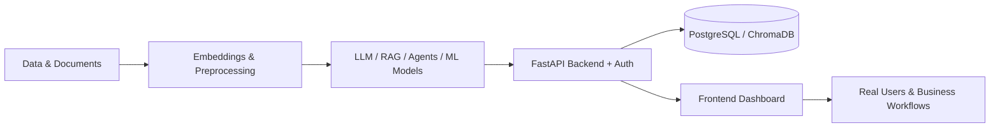

<h1>Abdullah Ishfaq</h1>

<h3>Full Stack AI / ML Engineer</h3>

<b>Specialization: Generative AI</b> 
LLM Applications &nbsp;•&nbsp; RAG Systems &nbsp;•&nbsp; AI Agents &nbsp;•&nbsp; AI Automation

 

Also building: Machine Learning · Deep Learning · Computer Vision · FastAPI Backends · Frontend Dashboards

  

 

  

<a href="#what-i-do">What I Do</a> &nbsp;•&nbsp;
<a href="#recruiter-snapshot">Snapshot</a> &nbsp;•&nbsp;
<a href="#technical-skills">Skills</a> &nbsp;•&nbsp;
<a href="#featured-projects">Projects</a> &nbsp;•&nbsp;
<a href="#experience">Experience</a> &nbsp;•&nbsp;
<a href="#contact">Contact</a>

---

## What I Do

I am a **Full Stack AI/ML Engineer** with **2+ years of experience** turning AI into **working, secure, production-ready products**. My core specialization is **Generative AI**, and I can own the rest of the stack around it.

<table>
  <tr>
    <td width="33%" valign="top" align="center">
      <h3>🧠 Generative AI</h3>
      <b>Core Specialization</b>
        
      LLM applications 
      RAG systems 
      AI agents and multi-agent workflows 
      AI automation 
      Prompt and context engineering
    </td>
    <td width="33%" valign="top" align="center">
      <h3>📊 Machine Learning & Vision</h3>
      <b>Strong Foundation</b>
        
      Machine learning 
      Deep learning 
      Computer vision 
      Explainable AI 
      Model evaluation and deployment
    </td>
    <td width="33%" valign="top" align="center">
      <h3>⚙️ Full Stack Delivery</h3>
      <b>End-to-End Ownership</b>
        
      FastAPI backends 
      PostgreSQL and vector databases 
      Authentication and role-based access 
      Frontend dashboards (HTML, CSS, JS) 
      Docker and Git
    </td>
  </tr>
</table>

I build the **whole product**, not just the model: data, AI logic, API, security and a usable interface. The result is AI that is **grounded, explainable and ready for real users**.

---

## Recruiter Snapshot

| | |
|---|---|
| **Title** | Full Stack AI/ML Engineer |
| **Specialization** | Generative AI: LLMs · RAG · AI Agents · AI Automation |
| **Also strong in** | Machine Learning · Deep Learning · Computer Vision · FastAPI · Frontend (HTML, CSS, JavaScript) |
| **Experience** | 2+ years in applied AI/ML; currently AI/ML Engineer at Web Synic |
| **Languages** | Python · JavaScript · SQL · HTML/CSS |
| **LLM providers** | OpenAI · Google Gemini · Anthropic · Ollama (local models) · Hugging Face |
| **Tools** | FastAPI · PostgreSQL · ChromaDB · LangChain · n8n · Docker · Git |
| **Roles of interest** | Generative AI Engineer · LLM Engineer · AI Agent Engineer · AI/ML Engineer · Computer Vision Engineer · AI Backend Engineer |
| **Work mode** | Open to on-site, hybrid and remote |
| **Contact** | [Email](mailto:00111abdullah00111@gmail.com) · [LinkedIn](https://www.linkedin.com/in/abdullah-1-11-) · [Portfolio](https://abdullahishfaq.netlify.app) |

---

## Technical Skills

| Domain | Technologies |
|---|---|
| **🧠 Generative AI & LLMs** *(specialization)* | LLM applications · RAG · AI agents · multi-agent systems · AI automation · LangChain · prompt engineering · context engineering · tool/function calling · OpenAI, Gemini and Anthropic APIs · Ollama · Hugging Face · n8n |
| **🔎 Vector Search & Embeddings** | ChromaDB · semantic search · Hugging Face and MiniLM embeddings · document chunking |
| **📊 Machine Learning** | Scikit-Learn · XGBoost · LightGBM · class-imbalance handling (SMOTE) · model selection and evaluation (F1, R², MAE, RMSE) |
| **🧬 Deep Learning** | PyTorch · transfer learning · fine-tuning · Grad-CAM (explainable AI) |
| **👁️ Computer Vision** | OpenCV · YOLOv8 · DeepSORT · face recognition · real-time video analytics |
| **⚙️ Backend & Data** | Python · FastAPI · REST APIs · PostgreSQL · authentication and RBAC · SMTP/IMAP |
| **🖥️ Frontend** | HTML · CSS · JavaScript · dashboards, chat UIs, admin panels, upload and results views |
| **🛠️ Tools** | Docker · Git · GitHub · Linux |

---

## Featured Projects

Projects are grouped by specialization. Every project has a public repository and a recorded demo.

### 🧠 Generative AI: LLMs, RAG, Agents & Automation

#### 📧 [MailMind AI Agent](https://github.com/Abdullah-1-11/mailmind-ai-enterprise-automation): Multi-Agent HR, ATS & Email Automation
*An AI SaaS that reads incoming emails, decides what they are, and acts on them automatically.*

- **Multi-agent system:** Email Classification Agent, Manager (Orchestrator) Agent, ATS Screening Agent, RAG Agent, Job Finder Agent
- **ATS resume scoring (0–100)** with weighted criteria, fit status, missing-skill analysis and an auto-generated HR-tone reply
- **Live Gmail automation** over IMAP/SMTP, including PDF attachment reading
- **RAG support answers** from company documents via ChromaDB
- **Stack:** `Python` `FastAPI` `PostgreSQL` `ChromaDB` `LangChain` `Ollama (Qwen 2.5)` `Multi-Agent` `RAG`

#### 📚 [DocuMind AI](https://github.com/Abdullah-1-11/DocuMind-AI): Enterprise RAG Knowledge Assistant
*Turns PDFs into a conversational knowledge base with answers grounded only in the uploaded documents.*

- **Fully local LLM** (Ollama + Qwen 2.5): no external API dependency, so company data stays private
- **Role-based access:** admins manage the knowledge base, users chat and review history
- **Document-grounded answers** designed to prevent hallucination
- **Secure auth** and persistent chat history in PostgreSQL
- **Stack:** `FastAPI` `LangChain` `ChromaDB` `Hugging Face Embeddings` `Ollama` `PostgreSQL`

### 👁️ Computer Vision

#### 🛡️ [AI Guardian](https://github.com/Abdullah-1-11/AI-Guardian-Intelligent-Surveillance-System): Real-Time AI Surveillance & Threat Intelligence
*Turns ordinary CCTV cameras into an intelligent security decision system.* · [🎥 Watch demo](https://drive.google.com/file/d/1PGt-Hj29uG8P7mSWQKRVQpPO8m5Kgz0B/view?usp=sharing)

- **Context-aware weapon detection:** a known guard carrying a weapon raises no alert, while an unknown person with a weapon triggers an immediate alert
- **End-to-end pipeline:** YOLOv8 detection → DeepSORT tracking → face recognition → custom weapon model → loitering detection → decision engine
- **Automated alerts:** image capture, pre-event video recording, email notification
- **Secure FastAPI dashboard** with live streaming and event history
- **Stack:** `YOLOv8` `DeepSORT` `OpenCV` `Face Recognition` `FastAPI` `Computer Vision`

### 🧬 Deep Learning & Explainable AI

#### 🩺 [DermaAI](https://github.com/Abdullah-1-11/DermaAI-Skin-Cancer-Detection-System): Explainable Skin Cancer Detection
*Deep learning with explainability, so predictions can be inspected and trusted.*

- **ResNet50 transfer learning** on HAM10000 (10,000 images, 7 classes)
- **87.3% test accuracy · 0.87 weighted F1**
- **Grad-CAM heatmaps** show which lesion regions drive each prediction
- FastAPI service returns the label, confidence and explanation image
- **Stack:** `PyTorch` `ResNet50` `Grad-CAM` `FastAPI` `OpenCV` `Explainable AI`

### 📊 Machine Learning

#### 💳 [Loan Default Prediction](https://github.com/Abdullah-1-11/Loan-Default-Prediction-WebApp): Credit Risk on Imbalanced Data
*Predicts whether a customer will default within two years.*

- Handled **extreme class imbalance (6.7% defaulters)** with SMOTE and used **F1 as the primary metric**
- Benchmarked **6 models** and selected **LightGBM**
- Served through a FastAPI `/predict` endpoint with a web frontend
- **Stack:** `LightGBM` `XGBoost` `SMOTE` `Scikit-Learn` `FastAPI`

#### 💰 [Salary Prediction](https://github.com/Abdullah-1-11/Salary-Prediction-Webapp): ML Regression Web App
*Predicts salary from experience, role, education and more.*

- Compared **7 regression models**; **Random Forest reached 97.9% R²**
- **Removed sensitive features (country, race)** deliberately to reduce bias
- Deployed as a FastAPI service with a clean web UI
- **Stack:** `Random Forest` `XGBoost` `LightGBM` `Scikit-Learn` `FastAPI`

### 📈 Results at a Glance

| Project | Area | Key result |
|---|---|---|
| MailMind AI Agent | Generative AI · multi-agent automation | 5 specialized agents with automated ATS scoring and email replies |
| DocuMind AI | Generative AI · RAG | Private, fully local, document-grounded Q&A |
| AI Guardian | Computer vision · security | Context-aware weapon and loitering alerts in real time |
| DermaAI | Deep learning · healthcare | 87.3% accuracy with Grad-CAM explainability |
| Loan Default Prediction | Machine learning · FinTech | Imbalance-aware model selected on F1 across 6 algorithms |
| Salary Prediction | Machine learning · HR analytics | 97.9% R² with bias-aware feature selection |

---

## Experience

| Role | Company | Period |
|---|---|---|
| **AI/ML Engineer** | Web Synic | Nov 2025 – Present |
| **Junior AI/ML Engineer** | Web Synic | Jun 2025 – Nov 2025 |
| **Machine Learning Intern** | Efaida Technologies | Jan 2025 – Apr 2025 |

---

## What I Bring to an AI Team

- ✅ **Generative AI depth:** LLM apps, RAG and multi-agent systems that automate real business workflows
- ✅ **End-to-end ownership:** from data and model to API, authentication and user interface
- ✅ **Production mindset:** secure APIs, role-based access, private and local LLM options, modular code
- ✅ **Trustworthy AI:** RAG that avoids hallucination, explainable models, metrics matched to the problem
- ✅ **Clear delivery:** documented repositories and recorded live demos for every project

---

## GitHub Activity

---

## Currently

- 🔨 Building production AI applications at **Web Synic**
- 🌱 Going deeper into **agentic workflows, LLM evaluation and scalable RAG architectures**
- 💼 **Open to** Generative AI Engineer, LLM Engineer, AI Agent Engineer, Full Stack AI/ML Engineer and Computer Vision Engineer roles

---

## Contact

  

*Building with LLMs, RAG, AI agents or computer vision? I'd love to hear about it.*

 

**Keywords:** Full Stack AI Engineer · Generative AI Engineer · LLM Engineer · RAG Engineer · Retrieval-Augmented Generation · AI Agents · Multi-Agent Systems · AI Automation · LangChain · AI/ML Engineer · Machine Learning Engineer · Deep Learning · Computer Vision Engineer · YOLOv8 · PyTorch · FastAPI · Python Developer · NLP · Pakistan

